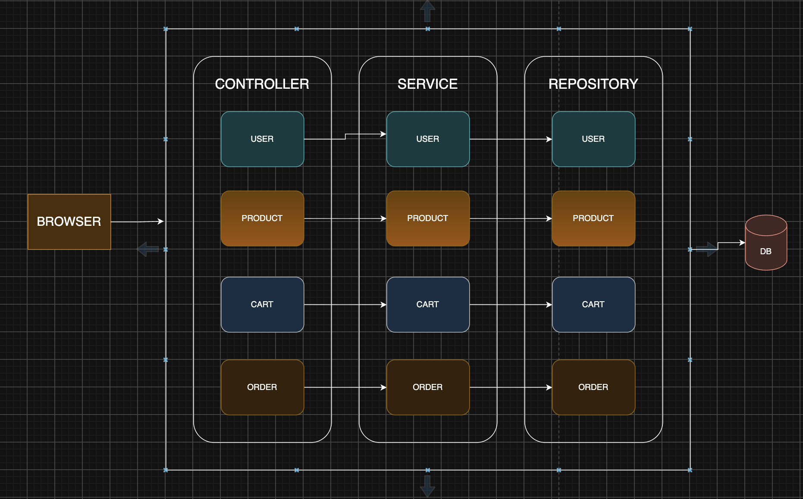

# E-commerce


## About This Project

This repository is the backend for an e-commerce platform built with Java and Spring Boot. It follows a modular, microservice-inspired architecture and is intended to support commerce workflows such as product management, user accounts, cart operations, and order processing.

The project is currently in an ongoing development stage and is designed to grow into a scalable backend foundation for a complete online shopping application.

## Project Overview

E-commerce is a Java-based application aimed at managing the core business logic behind a modern online store. The application organizes functionality into domain-oriented modules such as:

- Product management
- User and address handling
- Shopping cart operations
- Order lifecycle management

Each module is separated logically, which helps keep the codebase easier to maintain and extend as the platform grows.

## Architecture

<div align="center">
  <h1> Architecture Overview </h1>
  
</div>

The repository structure reflects a service-oriented and modular backend design. Instead of a single monolithic implementation, the application is organized around business domains, allowing teams to scale and evolve specific areas independently as the project expands.

The architecture includes:

- A central Spring Boot application entry point
- Domain-driven modules for product, user, cart, and order processing
- Data persistence with JPA and MySQL
- REST-style controller and service layers
- Structured resource and configuration files

## Tech Stack

- Java 17
- Spring Boot 4.1.1
- Maven
- Spring Data JPA
- MySQL Connector
- Validation and Actuator support

## Main Modules

### User Module
The User module handles customer and account-related data, including user profiles, addresses, roles, and core user management operations.

### Product Module
The Product module manages the catalog, product data, and product-related business logic, making it a central part of the commerce flow.

### Cart Module
The Cart module manages the user shopping cart and supports cart creation, updates, and retrieval.

### Order Module
The Order module manages purchase flows, order status, order items, and the lifecycle of transactions after checkout.


## Getting Started

### Prerequisites

Before running the project, ensure you have:

- Java 17+
- Maven 3.9+
- MySQL database configured
- Git installed
- An IDE such as IntelliJ IDEA or VS Code

### Clone the Repository

```bash
git clone https://github.com/lazyskiddie/E-commerce.git
cd E-commerce
```

### Build the Project

```bash
./mvnw clean install
```

### Run the Application

```bash
./mvnw spring-boot:run
```

## Configuration

Application configuration is defined in `src/main/resources/application.properties`. This file is used to configure runtime settings such as database connectivity and environment-specific properties.

## Development Notes

This repository is still under active development. As the platform grows, the project is expected to gain more services, API endpoints, and deeper commerce functionality. The current codebase demonstrates a strong foundation for e-commerce backend development with modular separation and maintainable Java classes.

## Contributing

Contributions are welcome as the project matures. For new work, prefer:

- clear naming and clean package organization
- readable controller/service logic
- proper validation and data modeling
- test coverage for core features
- updated documentation for new modules or behaviors

## Current Status

This project is an ongoing development effort focused on building a backend system for e-commerce applications. It is intended to evolve into a more complete commerce platform as new features and services are added.

## Summary

E-commerce is a Java-based backend project centered around essential online retail operations. With a modular architecture and a clear domain division across user, product, cart, and order components, the repository is positioned as a scalable foundation for a modern e-commerce system.
